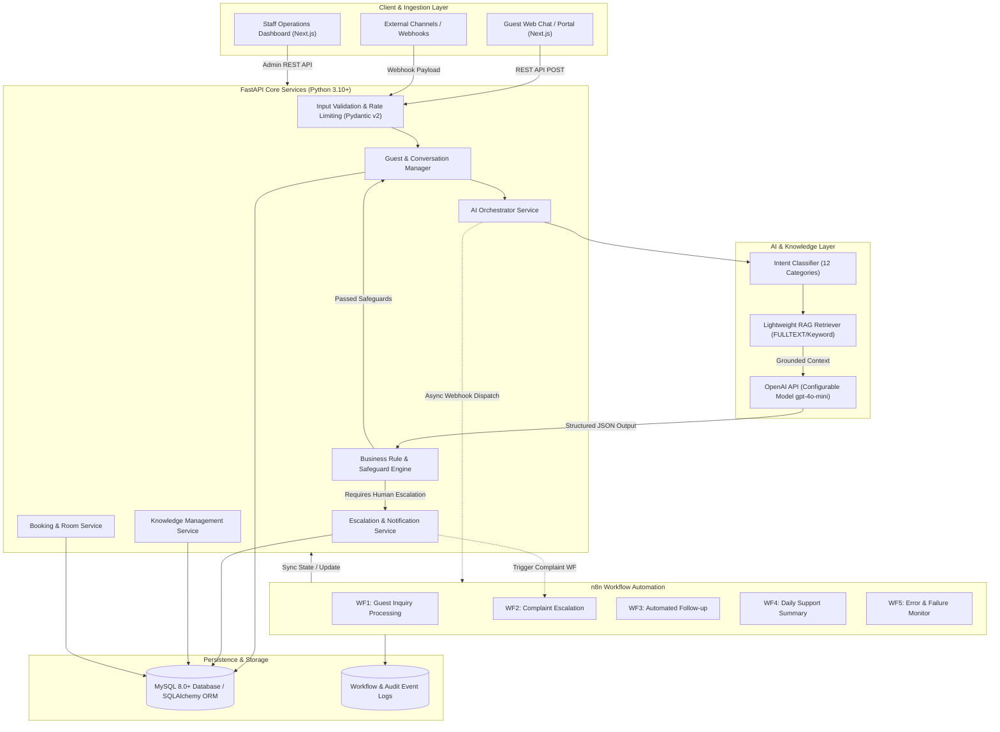

# AI-Powered Hotel Guest Support Automation System

[](https://fastapi.tiangolo.com)
[](https://nextjs.org)
[](https://react.dev)
[](https://www.mysql.com)
[](https://n8n.io)
[](https://openai.com)
[-brightgreen.svg)]()

> A professional-grade, multi-channel hospitality customer-support automation platform. Combines **FastAPI**, **Retrieval-Augmented Generation (RAG)**, **OpenAI**, **n8n Workflow Automation**, **MySQL 8**, and **Next.js** to automate repetitive hotel front-desk operations, triage guest messages, enforce human-in-the-loop policies, and manage live guest escalations.

---

## 1. Problem Statement & Objective

Hotels and luxury resorts receive thousands of inquiries every day regarding check-in timings, Wi-Fi passwords, amenities, late departures, dining menus, and reservation changes. Front-desk personnel are frequently bogged down answering repetitive questions rather than attending to arriving guests.

Meanwhile, generic AI chatbots hallucinate policies, invent promotional discounts, or mistakenly promise monetary refunds and unauthorized room modifications.

### Objective
Build an enterprise-grade AI automation platform for **Grand Azure Resort & Hotel** that:
1. **Understands Natural-Language Inquiries**: Categorizes messages into 12 domain-specific hotel intents.
2. **Grounds Responses with RAG**: Retrieves verified hotel policies directly from the knowledge base to prevent hallucinations.
3. **Enforces Strict Business Rules**: Automatically prohibits unauthorized refunds or room alterations and escalates high-risk cases to staff.
4. **Automates Operations via n8n**: Provides 5 exportable workflows for inquiry processing, complaint triage, scheduled guest follow-ups, daily audits, and error alerts.
5. **Provides a SaaS Operations Dashboard**: Equips front-desk teams with real-time analytics, conversation oversight, booking modification management, and live ticket resolution.

---

## 2. System Architecture



---

## 3. Technology Stack

- **Backend**: Python 3.10+, FastAPI 0.111.0, Pydantic v2, SQLAlchemy 2.0 ORM, PyMySQL, Cryptography, Jose (JWT), Pytest.
- **AI & Reasoning**: OpenAI API (configurable `gpt-4o-mini` / `gpt-4o`), Lightweight Grounded RAG Pipeline, Deterministic offline reasoning fallback for zero-cost demo environments.
- **Workflow Automation**: n8n v1+, Webhook Triggers, HTTP Request nodes, Cron triggers, Global Error Catcher.
- **Database**: MySQL 8.0+ (InnoDB, UTF-8 Unicode, FULLTEXT index), SQLite dialect fallback for instantaneous local zero-config testing.
- **Frontend**: Next.js 14 (App Router), React 18, TypeScript, Tailwind CSS, Lucide React icons.
- **DevOps**: Docker, Docker Compose, Multi-stage builds.

---

## 4. Key Functional Modules

### Module A: Guest Inquiry Management
- Supports multi-turn guest conversations with session tracking (`Conversation ID`).
- Ingests guest name, email, booking reference, and inquiry text.
- Formats conversational memory context for the AI reasoning agent.

### Module B: AI-Powered Concierge & Intent Triage
Classifies incoming guest messages into 12 standardized categories:
1. `booking_inquiry`
2. `check_in_information`
3. `check_out_information`
4. `room_availability`
5. `booking_modification`
6. `cancellation`
7. `hotel_facilities`
8. `wifi_issues`
9. `maintenance_requests`
10. `payment_inquiry`
11. `general_complaint`
12. `other`

Validates all model output via **Pydantic**:
```json
{
  "intent": "check_in_information",
  "confidence": 0.96,
  "priority": "normal",
  "requires_human": false,
  "response": "Our standard check-in time is 2:00 PM...",
  "extracted_information": {
    "booking_reference": "GAH-78901",
    "requested_date": "tomorrow"
  }
}
```

### Module C: Hotel Knowledge Base (RAG)
- Extracts verified property rules (pool hours, Wi-Fi password, cancellation rules, breakfast times, shuttle rates, pet fees).
- Isolates facts from response generation to prevent hallucinations.
- If information is missing, instructs the guest that front desk confirmation is in progress.

### Module D: Booking Management
- View reservations, check-in dates, room types, and statuses.
- Real-time room availability checker across date ranges.
- Submission of modification and cancellation requests with automatic state transitions (`pending_modification`, `pending_cancellation`).

### Module E: Human-in-the-Loop Escalation
Enforces strict safeguards where the AI is barred from:
- Approving refunds or promising financial compensation.
- Making unauthorized room modifications.
- Dismissing urgent complaints (e.g. broken AC, leaking pipes, repeat calls to reception).

---

## 5. n8n Automation Workflows

All workflows are pre-built and exportable as JSON files in `backend/n8n/workflows/`:

```
backend/n8n/workflows/
├── 01_guest_inquiry_processing.json     # Ingests payload, validates, runs AI, syncs DB
├── 02_complaint_escalation.json         # Urgent complaint triage, MySQL sync, alerts Duty Manager
├── 03_automated_guest_followup.json     # Scheduled scan of unresolved inquiries, drafts follow-up
├── 04_daily_support_summary.json        # 23:00 Cron calculating KPIs, formats AI digest for GM
└── 05_workflow_error_monitoring.json    # Global Error Trigger logging failures and retry steps
```

### How to Import into n8n:
1. Open n8n (`http://localhost:5678`).
2. Click **Workflows** → **Import from File...**.
3. Select any `.json` file from `backend/n8n/workflows/`.
4. Toggle **Active**.

---

## 6. Frontend SaaS Operations Dashboard

The modern dashboard includes 8 comprehensive views:

1. **Dashboard** (`/`): Real-time KPIs (total inquiries, AI-resolved count, pending escalations, average response latency, category distribution, live activity feed).
2. **Conversations** (`/conversations`): Filterable guest conversation threads with staff intervention and response capabilities.
3. **AI Support Chat** (`/chat`): Interactive sandbox with quick-test scenario buttons for live portfolio demonstrations.
4. **Booking Management** (`/bookings`): Active reservation records, room assignments, and modification/cancellation requests.
5. **Escalation Management** (`/escalations`): Ticket triage by priority (Urgent, High, Normal), staff notes, and resolution marking.
6. **Knowledge Base** (`/knowledge`): Full CRUD interface to update hotel FAQs and rules.
7. **Automation Monitoring** (`/monitoring`): Health statuses of all 5 n8n workflows with live execution telemetry logs from MySQL.
8. **Settings** (`/settings`): Configurable property details, AI model selection, confidence thresholds, and safe DEMO mode indicator.

---

## 7. Demonstration Scenarios

### Scenario 1: Booking & Check-in Inquiry
- **Guest**: John Smith (`john@example.com`, Booking Ref: `GAH-78901`)
- **Inquiry**: *"Hello, I have a booking for tomorrow. Could you tell me the check-in time and whether I can request an early check-in?"*
- **System Action**:
  - Classifies intent as `check_in_information` (confidence `0.95`).
  - RAG retrieves check-in policy and early arrival rules.
  - Returns: standard check-in is 2:00 PM; luggage storage complimentary; early check-in subject to room readiness.
  - `requires_human: false`. Conversation saved in MySQL.

### Scenario 2: Urgent AC Maintenance Complaint
- **Guest**: John Smith
- **Inquiry**: *"My room's air conditioning is not working, and I have already contacted reception twice."*
- **System Action**:
  - Recognizes repeat complaint and maintenance issue.
  - Assigns priority `urgent`, `requires_human: true`.
  - Automatically creates Escalation ticket `#1`.
  - Dispatches automated notification to Duty Manager via n8n Workflow 2.
  - Displays ticket immediately on Escalation Dashboard.

### Scenario 3: Cancellation & Refund Request
- **Guest**: John Smith
- **Inquiry**: *"Please cancel my reservation and issue a refund."*
- **System Action**:
  - Identifies intent as `cancellation`, priority `high`.
  - Explains the 48-hour cancellation policy.
  - AI strictly refuses to auto-refund and creates manager approval escalation ticket `#2`.
  - Updates reservation status to `pending_cancellation`.

---

## 8. Installation & Quickstart

### Option A: Docker Compose (Single Command)
```bash
# 1. Clone repository
git clone <repo-url>
cd hotel-guest-support-automation

# 2. Configure environment
cp .env.example .env

# 3. Launch all services
docker compose up -d
```
Access points:
- **Frontend Dashboard**: [http://localhost:3000](http://localhost:3000)
- **FastAPI Interactive Docs**: [http://localhost:8000/docs](http://localhost:8000/docs)
- **n8n Automation Platform**: [http://localhost:5678](http://localhost:5678)
- **MySQL 8 Database**: Port `3306`

---

### Option B: Local Development Setup

#### 1. Backend Setup
```bash
cd backend
python -m venv venv

# Activate (Windows: .\venv\Scripts\activate | Linux/macOS: source venv/bin/activate)
.\venv\Scripts\activate

pip install -r requirements.txt

# Run database setup & seed
python -m app.database.seed_data

# Start FastAPI server
uvicorn app.main:app --reload --host 0.0.0.0 --port 8000
```

#### 2. Frontend Setup
In a new terminal:
```bash
cd frontend
npm install
npm run dev
```
Open [http://localhost:3000](http://localhost:3000) in your browser.

---

## 9. Automated Test Suite Results

The automated Pytest test suite validates all modules with mocked AI responses (zero paid API cost):

```bash
cd backend
.\venv\Scripts\pytest tests -v
```

### Actual Execution Output:
```
============================= test session starts =============================
platform win32 -- Python 3.10.0, pytest-8.2.0, pluggy-1.7.0
configfile: pytest.ini
testpaths: tests
collected 21 items

tests/test_ai_agent.py::test_intent_classification_categories PASSED     [  4%]
tests/test_ai_agent.py::test_business_rules_safeguards PASSED            [  9%]
tests/test_ai_agent.py::test_end_to_end_ai_orchestration PASSED          [ 14%]
tests/test_analytics.py::test_dashboard_kpis_calculation PASSED          [ 19%]
tests/test_analytics.py::test_daily_summary_report PASSED                [ 23%]
tests/test_analytics.py::test_analytics_api_endpoints PASSED             [ 28%]
tests/test_bookings.py::test_booking_retrieval PASSED                    [ 33%]
tests/test_bookings.py::test_check_availability PASSED                   [ 38%]
tests/test_bookings.py::test_booking_modification_creates_escalation PASSED [ 42%]
tests/test_bookings.py::test_booking_cancellation_requires_human_approval PASSED [ 47%]
tests/test_bookings.py::test_booking_api_routes PASSED                   [ 52%]
tests/test_conversations.py::test_conversation_lifecycle PASSED          [ 57%]
tests/test_conversations.py::test_conversation_api PASSED                [ 61%]
tests/test_escalations.py::test_escalation_lifecycle PASSED              [ 66%]
tests/test_escalations.py::test_escalation_api PASSED                    [ 71%]
tests/test_guests.py::test_create_and_retrieve_guest PASSED              [ 76%]
tests/test_guests.py::test_guest_api_endpoints PASSED                    [ 80%]
tests/test_knowledge.py::test_knowledge_crud PASSED                      [ 85%]
tests/test_knowledge.py::test_knowledge_api PASSED                       [ 90%]
tests/test_webhooks.py::test_webhook_inbound_inquiry PASSED              [ 95%]
tests/test_webhooks.py::test_n8n_callback_and_logs PASSED                [100%]

======================= 21 passed in 0.57s =======================
```

---

## 10. Default Demo Credentials
- **Admin Email**: `admin@grandhotelazure.demo`
- **Admin Password**: `AdminHotel2025!`
- **Sample Guest**: `John Smith` (`john@example.com`)
- **Sample Booking**: `GAH-78901`
- **n8n User**: `admin` / `AdminHotelN8n2025!`

---

## 11. Project Directory Structure

```
hotel-guest-support-automation/
│
├── backend/
│   ├── app/
│   │   ├── api/
│   │   │   └── v1/
│   │   │       ├── endpoints/
│   │   │       │   ├── auth.py
│   │   │       │   ├── guests.py
│   │   │       │   ├── conversations.py
│   │   │       │   ├── bookings.py
│   │   │       │   ├── escalations.py
│   │   │       │   ├── knowledge.py
│   │   │       │   ├── analytics.py
│   │   │       │   ├── ai.py
│   │   │       │   └── webhooks.py
│   │   │       └── api.py
│   │   ├── core/
│   │   │   ├── config.py
│   │   │   ├── security.py
│   │   │   └── logging.py
│   │   ├── models/
│   │   │   ├── admin_user.py
│   │   │   ├── guest.py
│   │   │   ├── room.py
│   │   │   ├── booking.py
│   │   │   ├── conversation.py
│   │   │   ├── message.py
│   │   │   ├── knowledge.py
│   │   │   ├── escalation.py
│   │   │   ├── notification.py
│   │   │   └── workflow_log.py
│   │   ├── schemas/
│   │   ├── services/
│   │   ├── ai/
│   │   │   ├── prompts.py
│   │   │   ├── intent_classifier.py
│   │   │   ├── rag_engine.py
│   │   │   ├── business_rules.py
│   │   │   ├── client.py
│   │   │   └── response_generator.py
│   │   ├── database/
│   │   │   ├── base.py
│   │   │   ├── session.py
│   │   │   └── seed_data.py
│   │   ├── integrations/
│   │   │   └── n8n_client.py
│   │   └── main.py
│   ├── n8n/
│   │   └── workflows/
│   │       ├── 01_guest_inquiry_processing.json
│   │       ├── 02_complaint_escalation.json
│   │       ├── 03_automated_guest_followup.json
│   │       ├── 04_daily_support_summary.json
│   │       └── 05_workflow_error_monitoring.json
│   ├── tests/
│   │   ├── conftest.py
│   │   ├── test_ai_agent.py
│   │   ├── test_analytics.py
│   │   ├── test_bookings.py
│   │   ├── test_conversations.py
│   │   ├── test_escalations.py
│   │   ├── test_guests.py
│   │   ├── test_knowledge.py
│   │   └── test_webhooks.py
│   ├── pytest.ini
│   ├── requirements.txt
│   └── Dockerfile
│
├── frontend/
│   ├── src/
│   │   ├── app/
│   │   │   ├── bookings/page.tsx
│   │   │   ├── chat/page.tsx
│   │   │   ├── conversations/page.tsx
│   │   │   ├── escalations/page.tsx
│   │   │   ├── knowledge/page.tsx
│   │   │   ├── monitoring/page.tsx
│   │   │   ├── settings/page.tsx
│   │   │   ├── page.tsx
│   │   │   ├── layout.tsx
│   │   │   └── globals.css
│   │   ├── components/
│   │   │   ├── Sidebar.tsx
│   │   │   └── Header.tsx
│   │   └── lib/
│   │       └── api.ts
│   ├── package.json
│   ├── tsconfig.json
│   ├── tailwind.config.js
│   ├── postcss.config.js
│   ├── next.config.js
│   └── Dockerfile
│
├── database/
│   ├── init.sql
│   └── seed.sql
│
├── docs/
│   ├── architecture.md
│   ├── api-documentation.md
│   ├── n8n-workflows.md
│   ├── database-schema.md
│   └── setup-guide.md
│
├── .env.example
├── .gitignore
├── docker-compose.yml
├── DEVELOPMENT_PROGRESS.md
└── README.md
```

---

## 12. Security & Reliability

- **Strict Secret Isolation**: Environment variables for all keys, tokens, and DB passwords (`.env.example` template provided, `.env` git-ignored).
- **Injection Protection**: System prompts isolate user inputs with explicit delimiters; RAG facts strictly bounded.
- **Safe DEMO Mode**: `MOCK_DELIVERY=true` guarantees emails and SMS are recorded to the database without sending external messages during testing.
- **Financial Authorization Safeguard**: AI responses are barred through code-level validation from confirming refunds or booking changes without staff sign-off.
- **Resilient Fallback**: Intelligent rule-based engine activates automatically if the OpenAI API is unreachable or unconfigured.

---

## 13. License
MIT License. Created as a showcase portfolio project for Senior AI Automation Specialist positions.

