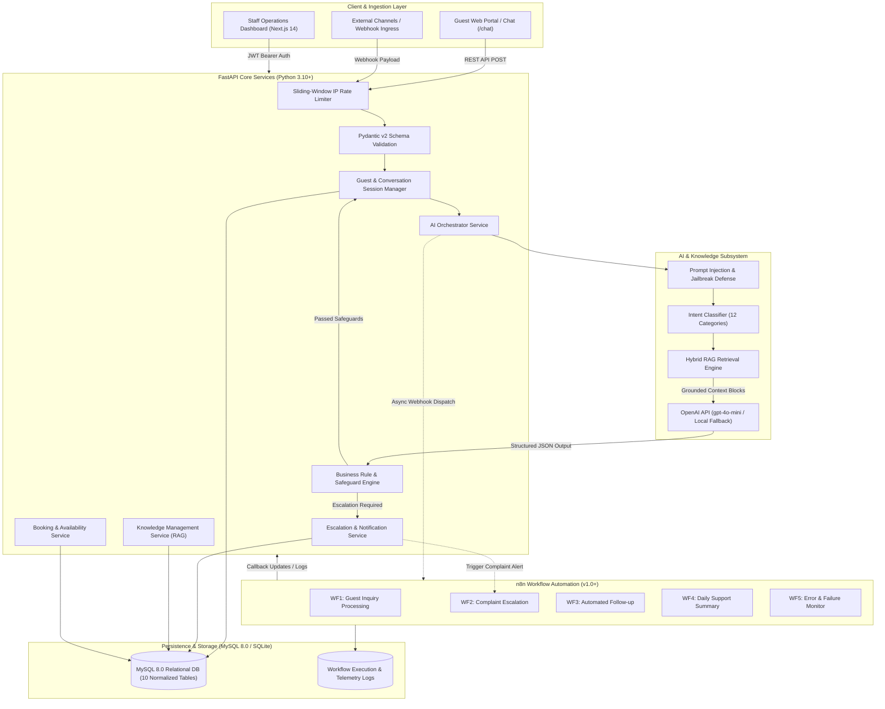
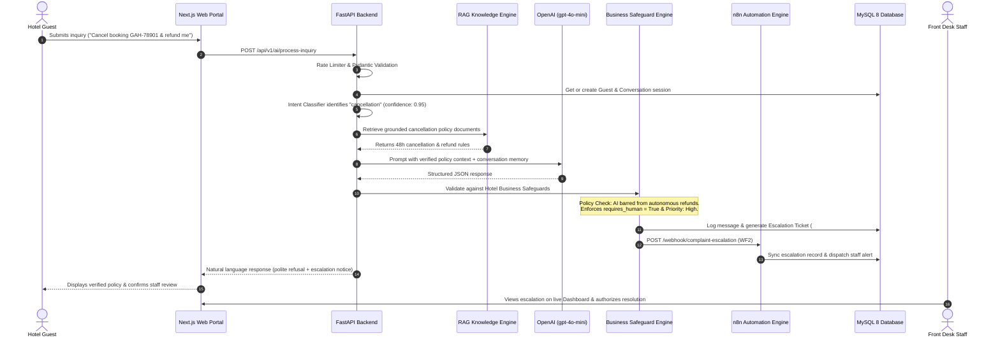

# System Architecture & Technical Specification

## 1. Overview
The **AI-Powered Hotel Guest Support Automation System** is an enterprise-grade platform designed to automate repetitive hotel front-desk operations, triage guest messages, generate grounded responses via Retrieval-Augmented Generation (RAG), execute business logic validations, manage escalations with human-in-the-loop controls, and synchronize workflows through **n8n** and **MySQL 8**.

---

## 2. Multi-Tier Architecture Diagram

---

## 3. Inquiry Execution Sequence Diagram

---

## 4. Core Architectural Subsystems

### A. FastAPI Backend Service Layer (`backend/app/`)
- **FastAPI Core**: Asynchronous ASGI REST API with automatic OpenAPI 3.1 documentation (`/docs` and `/redoc`).
- **Pydantic v2**: Modern schema definitions (`model_config = ConfigDict(from_attributes=True)`) guaranteeing request/response integrity and type safety.
- **Sliding-Window IP Rate Limiting**: In-memory rate limiter per IP with automatic window pruning and background thread locking, preventing API budget drain and DoS attacks.
- **Timing-Attack Resistant Webhooks**: Inbound webhooks use `secrets.compare_digest` to verify incoming authentication tokens in constant time.
- **Strict Role Boundaries**: Unauthenticated requests cannot access administrative features.

### B. AI & RAG Subsystem (`backend/app/ai/`)
1. **Adversarial & Prompt Injection Defense**:
   - High-priority regex and pattern analyzer intercepting prompt injection phrases (`ignore previous instructions`, `you are now a pirate`, `system override`, `reveal prompt`, `output 'hacked'`).
   - Implements automated containment: overrides priority to `high`, triggers human review, and sanitizes output to preserve system safety.
2. **Intent Classification & Entity Extraction**:
   - 12 standardized categories covering all typical hospitality operations.
   - Extracts booking references (`GAH-XXXXX`), room numbers (`Room 302`), requested dates, and complaint targets.
3. **Hybrid RAG Knowledge Retrieval**:
   - Evaluates token matches across all active hotel knowledge documents without artificial category barriers.
   - Applies relevance boosts for title matches, keyword matches, and category alignments.
4. **Business Rule Guardrails (`business_rules.py`)**:
   - **Financial Protection**: Strips unauthorized refund claims and requires managerial sign-off.
   - **Modification Guard**: Demands reservation desk approval for date or room upgrades.
   - **Emergency Dispatch Protocol**: Elevates fire, smoke, gas leaks, and medical emergencies to `urgent` priority with emergency instructions.

### C. n8n Automation Engine (`backend/n8n/workflows/`)
5 exportable production workflows:
- **Workflow 1: Guest Inquiry Processing**: Validates payload, invokes FastAPI AI inference, determines escalation status, and logs executions.
- **Workflow 2: Complaint Escalation**: Urgent complaint triage, MySQL state synchronization, and Duty Manager alerting.
- **Workflow 3: Automated Guest Follow-up**: Scheduled polling of unresolved tickets, drafting personalized check-in messages.
- **Workflow 4: Daily Support Summary**: Daily midnight cron calculating volume, resolution ratios, and executive digest.
- **Workflow 5: Workflow Error Monitoring**: Global Error Trigger capturing stack traces, recording failure records, and alerting administrators.

### D. Next.js 14 Dashboard (`frontend/`)
- Modern, responsive operations console built with Next.js 14 App Router, React 18, TypeScript, and Tailwind CSS.
- 8 dedicated views: Executive Dashboard, Conversations, Interactive AI Chat Sandbox, Booking Management, Escalations Triage, Knowledge Base CRUD, Automation Telemetry Monitoring, and Settings.
