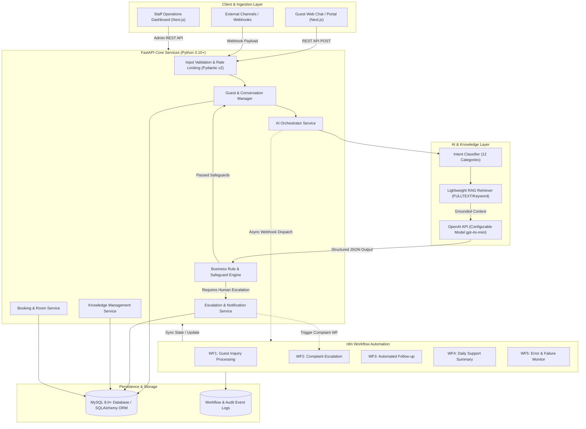

# System Architecture & Technical Specification

## 1. Overview
The **AI-Powered Hotel Guest Support Automation System** is an enterprise-grade platform designed to automate repetitive hotel front-desk operations, triage guest messages, generate grounded responses via Retrieval-Augmented Generation (RAG), execute business logic validations, manage escalations with human-in-the-loop controls, and synchronize workflows through **n8n** and **MySQL 8**.

---

## 2. End-to-End Architecture Workflow

---

## 3. Core Architectural Modules

### A. FastAPI Backend (`/backend/app/`)
- **FastAPI Framework**: High performance async REST API with automatic OpenAPI / Swagger interactive documentation (`/docs`).
- **Pydantic v2 Schemas**: Strict schema validation for all inputs, outputs, and AI structured outputs.
- **Service-Oriented Design**: Pure business logic separated from API endpoint route handlers.
- **Security & Authorization**: Bearer token JWT authentication for staff/admin endpoints, API key validation for webhooks.

### B. AI & RAG Subsystem (`/backend/app/ai/`)
1. **Configurable Model Engine**: Dynamic model parameterization (`OPENAI_MODEL_NAME`, default `gpt-4o-mini`) via environment variables.
2. **Intent Classification**: Evaluates input against 12 standardized hotel categories:
   - `booking_inquiry`, `check_in_information`, `check_out_information`, `room_availability`
   - `booking_modification`, `cancellation`, `hotel_facilities`, `wifi_issues`
   - `maintenance_requests`, `payment_inquiry`, `general_complaint`, `other`
3. **Retrieval-Augmented Generation (RAG)**: Extracts verified hotel policies, dining hours, Wi-Fi keys, and amenities prior to prompting the LLM. Completely isolates retrieved facts from response generation to prevent hallucinations.
4. **Hotel Business Safeguards (`business_rules.py`)**:
   - **Financial/Booking Guard**: The AI is strictly barred from approving refunds, confirming modifications, or executing cancellations autonomously.
   - **Confidence Threshold**: Any prediction with confidence below configurable `AI_CONFIDENCE_THRESHOLD` (0.75 default) triggers automatic escalation.
   - **Urgency Detector**: Urgent maintenance or repeated complaints immediately spawn an escalation ticket with high priority.

### C. n8n Automation Engine (`/backend/n8n/workflows/`)
Full, exportable, production-ready n8n workflows:
- **Workflow 1: Guest Inquiry Processing**: Ingests incoming guest messages, invokes backend AI processing, checks escalation rules, and records transaction logs.
- **Workflow 2: Complaint Escalation**: Flags urgent complaints, notifies front-desk operations team, logs escalation in MySQL.
- **Workflow 3: Automated Guest Follow-up**: Runs scheduled checks for inquiries left open or unresolved, generating polite check-in messages.
- **Workflow 4: Daily Support Summary**: Daily cron job calculating inquiry volume, category distribution, resolution ratios, and AI performance metrics.
- **Workflow 5: Workflow Error Monitoring**: Global error catcher logging failures to `workflow_logs` and notifying on-call admins.

### D. Next.js SaaS Operations Dashboard (`/frontend/`)
- Modern, responsive dashboard engineered with **React 19**, **Next.js**, **TypeScript**, and **Tailwind CSS**.
- Real-time interaction with the FastAPI backend across 8 purpose-built views:
  1. Executive Dashboard (KPI metrics, inquiry statistics, category breakdown)
  2. Guest Conversations (Active and historical threads)
  3. Interactive AI Support Chat (Simulated guest portal and interactive test harness)
  4. Booking Management (Live reservation records and modification workflow)
  5. Escalation Management (Triage, staff notes, and resolution actions)
  6. Knowledge Base (Full CRUD for hotel FAQs and rules)
  7. Automation Monitoring (Live n8n workflow health and execution logs)
  8. Hotel & System Settings (Configurable thresholds and integrations)

