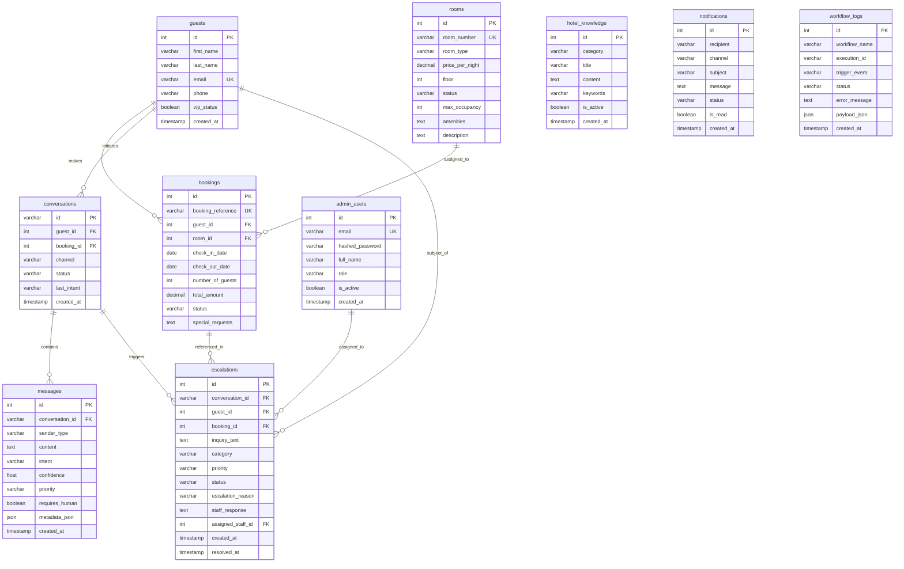

# Database Schema Documentation

## Database Engine: MySQL 8.0+ (InnoDB, UTF-8 Unicode)
*(SQLite 3 dialect supported as fallback for local testing and CI/CD)*

---

## Entity Relationship Overview

---

## Detailed Table Definitions

### 1. `guests`
Stores guest contact details and VIP tier.
- `id` (INT, PK, AUTO_INCREMENT)
- `first_name` (VARCHAR 100, NOT NULL)
- `last_name` (VARCHAR 100, NOT NULL)
- `email` (VARCHAR 255, NOT NULL, UNIQUE, INDEXED)
- `phone` (VARCHAR 50, NULL)
- `vip_status` (BOOLEAN, DEFAULT FALSE)
- `created_at` / `updated_at` (TIMESTAMP)

### 2. `admin_users`
Stores hotel support personnel and managers.
- `id` (INT, PK, AUTO_INCREMENT)
- `email` (VARCHAR 255, NOT NULL, UNIQUE, INDEXED)
- `hashed_password` (VARCHAR 255, NOT NULL) - bcrypt hash
- `full_name` (VARCHAR 150, NOT NULL)
- `role` (VARCHAR 50, DEFAULT 'support_agent') - 'manager', 'receptionist', 'support_agent'
- `is_active` (BOOLEAN, DEFAULT TRUE)

### 3. `rooms`
Physical hotel room inventory.
- `id` (INT, PK, AUTO_INCREMENT)
- `room_number` (VARCHAR 20, NOT NULL, UNIQUE)
- `room_type` (VARCHAR 100, NOT NULL)
- `price_per_night` (DECIMAL 10,2, NOT NULL)
- `floor` (INT, NOT NULL, DEFAULT 1)
- `status` (VARCHAR 50, DEFAULT 'available') - 'available', 'occupied', 'maintenance', 'reserved'
- `max_occupancy` (INT, DEFAULT 2)
- `amenities` (TEXT, NULL)
- `description` (TEXT, NULL)

### 4. `bookings`
Simulated demo reservations.
- `id` (INT, PK, AUTO_INCREMENT)
- `booking_reference` (VARCHAR 50, NOT NULL, UNIQUE, INDEXED)
- `guest_id` (INT, NOT NULL, FK -> guests.id)
- `room_id` (INT, NOT NULL, FK -> rooms.id)
- `check_in_date` (DATE, NOT NULL)
- `check_out_date` (DATE, NOT NULL)
- `number_of_guests` (INT, DEFAULT 1)
- `total_amount` (DECIMAL 10,2, NOT NULL)
- `status` (VARCHAR 50, DEFAULT 'confirmed') - 'confirmed', 'pending_modification', 'pending_cancellation', 'cancelled', 'completed'
- `special_requests` (TEXT, NULL)

### 5. `conversations`
Guest support sessions grouping inquiries.
- `id` (VARCHAR 64, PK) - UUID or nanoid
- `guest_id` (INT, NOT NULL, FK -> guests.id)
- `booking_id` (INT, NULL, FK -> bookings.id)
- `channel` (VARCHAR 50, DEFAULT 'web_chat') - 'web_chat', 'email', 'webhook'
- `status` (VARCHAR 50, DEFAULT 'active') - 'active', 'escalated', 'closed'
- `last_intent` (VARCHAR 100, NULL)

### 6. `messages`
Individual turns within a conversation.
- `id` (INT, PK, AUTO_INCREMENT)
- `conversation_id` (VARCHAR 64, NOT NULL, FK -> conversations.id)
- `sender_type` (VARCHAR 50, NOT NULL) - 'guest', 'ai', 'staff', 'system'
- `content` (TEXT, NOT NULL)
- `intent` (VARCHAR 100, NULL)
- `confidence` (FLOAT, NULL)
- `priority` (VARCHAR 50, DEFAULT 'normal') - 'low', 'normal', 'high', 'urgent'
- `requires_human` (BOOLEAN, DEFAULT FALSE)
- `metadata_json` (JSON, NULL)

### 7. `hotel_knowledge`
Hotel policies, FAQs, and guides for the RAG engine.
- `id` (INT, PK, AUTO_INCREMENT)
- `category` (VARCHAR 100, NOT NULL, INDEXED)
- `title` (VARCHAR 255, NOT NULL)
- `content` (TEXT, NOT NULL)
- `keywords` (VARCHAR 255, NULL)
- `is_active` (BOOLEAN, DEFAULT TRUE)
- FULLTEXT INDEX `idx_knowledge_search` (title, content, keywords)

### 8. `escalations`
Human support tickets requiring staff authorization or response.
- `id` (INT, PK, AUTO_INCREMENT)
- `conversation_id` (VARCHAR 64, NOT NULL, FK -> conversations.id)
- `guest_id` (INT, NOT NULL, FK -> guests.id)
- `booking_id` (INT, NULL, FK -> bookings.id)
- `inquiry_text` (TEXT, NOT NULL)
- `category` (VARCHAR 100, NOT NULL)
- `priority` (VARCHAR 50, DEFAULT 'normal') - 'low', 'normal', 'high', 'urgent'
- `status` (VARCHAR 50, DEFAULT 'pending') - 'pending', 'assigned', 'in_progress', 'resolved'
- `escalation_reason` (VARCHAR 255, NOT NULL)
- `staff_response` (TEXT, NULL)
- `assigned_staff_id` (INT, NULL, FK -> admin_users.id)
- `resolved_at` (TIMESTAMP, NULL)

### 9. `notifications`
Audit of simulated or external alerts sent to hotel staff.
- `id` (INT, PK, AUTO_INCREMENT)
- `recipient` (VARCHAR 255, NOT NULL)
- `channel` (VARCHAR 50, DEFAULT 'email')
- `subject` (VARCHAR 255, NOT NULL)
- `message` (TEXT, NOT NULL)
- `status` (VARCHAR 50, DEFAULT 'sent')
- `is_read` (BOOLEAN, DEFAULT FALSE)

### 10. `workflow_logs`
Audit log of n8n webhook triggers and batch executions.
- `id` (INT, PK, AUTO_INCREMENT)
- `workflow_name` (VARCHAR 150, NOT NULL, INDEXED)
- `execution_id` (VARCHAR 100, NULL)
- `trigger_event` (VARCHAR 100, NOT NULL)
- `status` (VARCHAR 50, NOT NULL) - 'success', 'failed', 'retried'
- `error_message` (TEXT, NULL)
- `payload_json` (JSON, NULL)

